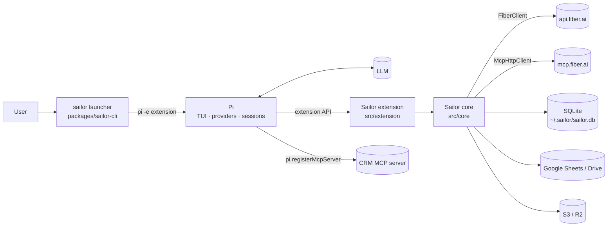
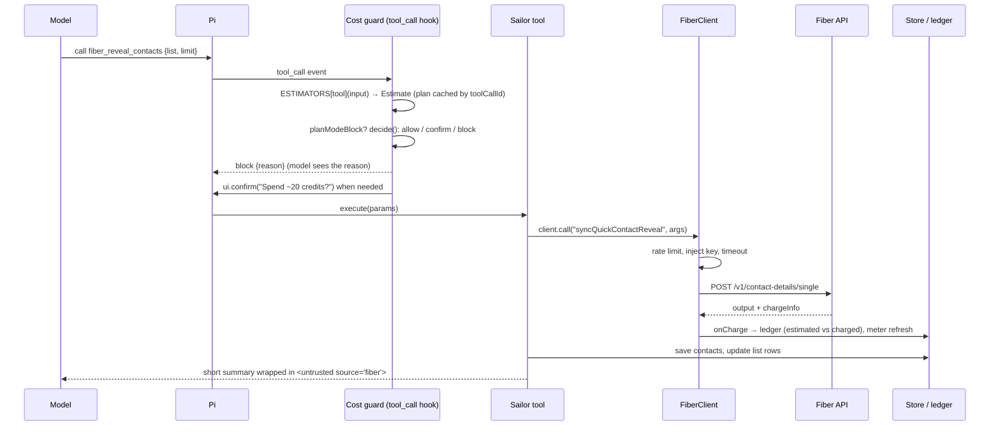

# Architecture

How Sailor is put together, as built. For the original design rationale see [docs/03_Architecture.md](../03_Architecture.md); where the two differ, this page and the code win.

## The big picture

Sailor is a **Pi extension package** plus an optional launcher. Pi provides the terminal UI, LLM providers, sessions, tool calling, skills and prompt templates. Sailor registers tools, commands, hooks, UI components, skills, prompts and themes through Pi's extension API, and keeps its own state in a local SQLite database.



## Packages

| Path | Package | Role |
|---|---|---|
| `packages/pi-fiber` | `@sailor/pi-fiber` | The Pi package. Its `package.json` `pi` manifest points Pi at `extensions/`, `skills/`, `prompts/` and `themes/` |
| `packages/sailor-cli` | `sailor-gtm` (bin `sailor`) | Plain-JS launcher: onboarding, `login`, `doctor`, theming, passthrough to `pi`. No build step, no dependencies |
| `evals/` | – | Mock Fiber API + MCP server and the multi-model agent eval runner |
| `types/shims/` | – | Minimal type declarations for Pi and the SDK, for `npm run typecheck:offline` |

## Two layers inside `pi-fiber`

```
packages/pi-fiber/
  extensions/sailor/index.ts    ← entry Pi loads; re-exports src/extension/index.ts
  src/core/                     ← no Pi imports. Usable from scripts, the CLI and tests
  src/extension/                ← Pi wiring: tools, commands, hooks, UI
  skills/ prompts/ themes/      ← Pi resources
  test/                         ← node:test suites + stubs for the Pi packages
```

**`src/core` must never import Pi.** It's exported as `@sailor/pi-fiber/core` and is what scripts, the CLI and most tests use.

### `src/core`

| Module | Responsibility |
|---|---|
| `config.ts` | `SailorConfig`, defaults, global → project → env merge, `saveGlobalConfig` |
| `secrets.ts` | Keychain (`security` / `secret-tool`) or 0600 file; key resolution order; profiles; sandbox key lookup |
| `redact.ts` | Masks Fiber keys, bearer tokens, Google tokens, AWS signatures and `apiKey=` params |
| `errors.ts` | Typed errors: `InvalidKeyError` (401), `OutOfCreditsError` (402), `RateLimitedError` (429), `SandboxUnsupportedError` (501), `UnknownOutcomeError`, `BlockedByPolicyError` |
| `budget.ts` | `decide()`: the pure cost-policy function (allow / confirm / block) |
| `fiber/ops.ts` | **Operation registry**: method, path, paid, idempotent, rpm, deny/admin flags and an estimator for each known Fiber operation |
| `fiber/pricing.ts` | Static price book, overridden by live `creditsPerOperation` (centi-credits) from `getOrgCredits` |
| `fiber/client.ts` | `FiberClient`: the only way to call Fiber over HTTP |
| `fiber/ratelimit.ts` | Per-operation token buckets |
| `fiber/catalog.ts` | Loads and searches Fiber's operation catalog; fetches per-op agent docs |
| `fiber/entities.ts` | Turns raw Fiber payloads into compact `PersonSummary` / `CompanySummary` |
| `fiber/sandbox.ts` | Sandbox key detection, operations Fiber hasn't sandboxed, tools to hide |
| `gtm.ts` | High-level operations: search, count, parse, resolve, bulk resolve, reveal and validate, with caching and list writes |
| `prospecting.ts` | List profiling, score saving, narrowing, social extraction |
| `grounding.ts` | `asUntrusted()` wrapper, citation checks, protected-attribute detection |
| `store/db.ts` | `Store`: SQLite schema, migrations and every query |
| `io/` | File reading (CSV/TSV/XLSX, encodings), CSV parsing, column-role detection, normalisers |
| `repair/engine.ts` | Pre-flight, engine choice, Kitchen Sink repair, Mosaic chunking/start, job handlers, healed-CSV import |
| `jobs/manager.ts` | Persistent job manager with Fiber-friendly polling |
| `hosting/` | Manual, Google Drive and S3/R2 hosting for Mosaic, with persisted cleanup |
| `google/` | OAuth (loopback + PKCE, device flow), Sheets read/write/upsert, Drive upload/permissions |
| `mcp/client.ts` | Minimal Streamable-HTTP MCP client (JSON and SSE responses, session re-init) |
| `export/rows.ts` | Export presets, DNC filtering, formula escaping |
| `crm.ts` | CRM definitions (MCP server entries, sign-in steps, agent hints) and CRM-ready rows |
| `time.ts` | Local time and best call window from a timezone |

### `src/extension`

| Module | Responsibility |
|---|---|
| `index.ts` | The extension factory: registers flags, tools, guard, commands, shortcuts and lifecycle hooks |
| `runtime.ts` | `Runtime` singleton: config, key, `FiberClient`, `Store`, `Pricing`, `Gtm`, `JobManager`, `CreditMeter`. Initialised lazily with `rt.init(ctx)` |
| `costGuard.ts` | `tool_call` hook and `approveSpend()` for commands and panes |
| `modes.ts` | Persona and tools-profile gating (`computeActiveTools`) |
| `agentMode.ts` | Build / Plan / Sandbox: commands, `Alt+M`, key swap, MCP toggle, "run the plan" follow-up |
| `prompt.ts` | System-prompt addendum, rebuilt every turn from mode and state |
| `meter.ts` | Footer credit meter and refresh schedule |
| `actions.ts` | Shared reveal / validate / resolve planning and execution (used by tools, commands and the pane) |
| `tools/*.ts` | Tool definitions, via `registerSailorTool()` in `tools/common.ts` |
| `commands/*.ts` | Slash commands |
| `ui/` | `ListPane`, cards, text helpers, text viewer, the Fiber look (header, footer, spinner, themes) |

## Lifecycle

1. **Load.** Pi imports `extensions/sailor/index.ts` and calls the default export with the `ExtensionAPI`. Sailor registers flags, ~30 tools, the cost guard, commands, shortcuts and, if a CRM is configured, the CRM MCP server.
2. **`session_start`.** `rt.init(ctx)` loads config, resolves the key (sandbox key in Sandbox mode), opens the store and builds the client, pricing, GTM service, job manager and meter. CLI flags are applied, the Fiber look installed, the meter started, persisted jobs resumed, and the Fiber MCP bridge connected in the background (skipped in sandbox and the `lite` profile). `applyMode()` sets the active tools.
3. **`before_agent_start`** (every turn). Resets the per-turn paid-call counter, re-applies tool gating (picking up newly connected MCP tools), and appends `systemPromptAddendum(rt)` to the system prompt.
4. **`input`.** If the message contains a Fiber key, offers to store it and replaces it with a masked version before the model sees it.
5. **`tool_call`.** The cost guard (below).
6. **`tool_result`.** Redacts secrets from every tool result, including `bash` output, before it enters the context or the session file.
7. **`agent_end`.** In Plan mode, if the reply looks like a numbered plan, offers to run it in Build or Sandbox.
8. **`session_shutdown`.** Stops jobs and the meter, closes MCP sessions.

## A paid tool call, end to end



Key points:

- **Estimators live next to tools.** `registerSailorTool({ estimate })` puts the estimator in a global `ESTIMATORS` map that the guard reads. Tools with no estimator are free. An estimator can stash its computed plan in `rt.plans` under the `toolCallId` so `execute` doesn't recompute it (and runs exactly what was approved).
- **`decide()` is pure** and fully unit-tested: dry run → per-turn cap → balance → session and daily budgets → pre-approval → threshold, uncertainty and `forceConfirm` → headless allowance → confirm.
- **Commands and panes** call `approveSpend()` directly with the same estimate shape, so a human action and a model action are held to the same rules.
- **Shell commands** that mention `api.fiber.ai`, `mcp.fiber.ai`, `@fiberai/sdk` or the key variables get a forced confirmation, because they bypass the guard.

## FiberClient

Every Fiber HTTP call goes through `FiberClient.call(opId, args, opts)`:

- Looks up the operation in the registry (or takes `method` and `path` for catalog-only operations) and fills path parameters.
- Injects the key at call time (the `x-api-key` header, plus the `apiKey` body or query field Fiber expects) and strips any `apiKey` the caller passed; keys never appear in tool schemas.
- Applies a per-operation token bucket and honours `Retry-After` on 429. A 429 means the request wasn't processed, so it's safe to retry even for paid operations.
- Retries 5xx and timeouts **only for idempotent operations**. A paid, non-idempotent call that times out raises `UnknownOutcomeError` instead of retrying.
- Maps 401, 402 and 501 (sandbox) to typed errors. On a sandbox key, operations known not to be sandboxed fail locally without a network call; new 501s are learned at runtime.
- Extracts `chargeInfo` and emits a `ChargeEvent`, which the runtime writes to the ledger alongside the estimate.

## Data model

One SQLite file (`node:sqlite`, WAL mode), created with permissions `0600`. Schema in `src/core/store/db.ts`; additive migrations run on open.

| Table | Holds |
|---|---|
| `lists` | `id` (slug), unique `name`, `kind` (`people`/`companies`), `source`, timestamps |
| `entities` | People and companies. `dedupe_key` (LinkedIn → email → name+domain, or `raw:` for unresolved rows), `summary` (compact JSON the model sees), `data` (full payload), `source_op`, `fetched_at` |
| `list_items` | List membership: `position`, `status`, `notes`, original `input` row, plus `score`, `tier`, `score_reason` |
| `contacts` | Emails and phones per entity with `validity`, `source_op`, `fetched_at` |
| `jobs` | Async jobs: kind, Fiber op and remote id, status, params, result, next poll time, error |
| `cache` | Response cache (contact reveals, email verdicts) with TTL |
| `ledger` | One row per charge: session, op, estimated, charged, method, raw `chargeInfo` |
| `exports` | Export history (target, URL or path, mode); used to re-find the last sheet for upserts |
| `dnc` | Do-not-contact values by kind (email, domain, linkedin, phone) |
| `repairs` | File hash → previous repair, to warn about re-running the same file |

## Jobs

`JobManager` stores jobs in SQLite, so they survive restarts. Handlers implement `poll`, an idempotent `finalize`, and optionally `onFailed` and `cancel`. Two are registered:

- `mosaic`: polls `pollMosaic`, cleans up hosting once the run leaves `pending`, downloads the healed CSV and report, imports into the target list.
- `batch_contacts`: polls `pollBatchContactDetails` and streams results into the list.

Polling follows Fiber's guidance: every 30 seconds, every 60 after ten minutes. Progress shows in a widget above the editor; completion is announced in the conversation (without triggering a model turn).

## Modes and tool gating

`computeActiveTools()` decides which registered tools the model can see, in this order:

1. Sandbox key: hide tools that only wrap unsandboxed operations.
2. Plan mode: hide `bash`, `edit`, `write` and CRM MCP tools.
3. `lite` profile: only `LITE_TOOLS` plus `read`.
4. Not `engineer`: hide `bash`, `edit`, `write`.

Hiding is a usability and safety layer; the cost guard is the enforcement layer. Even a visible tool can't spend in Plan mode or dry run.

## Security model

| Threat | Mitigation |
|---|---|
| Key leaks to the model, logs or exports | Injected only in `FiberClient`; `input` and `tool_result` hooks redact; `maskKey` everywhere; CI greps session files for live keys |
| Runaway spend | Estimates, confirmations, session/daily budgets, per-turn cap, dry run, Plan mode, headless block |
| Money movement or account takeover via the agent | `deny` operations in the registry are blocked; key admin needs `/fiber admin on` |
| Prompt injection from scraped data | Third-party text wrapped in `<untrusted source="…">`; system prompt forbids following it or sending data to URLs in it; eval E6 |
| Spreadsheet formula injection | Export cells starting with `= + - @` are escaped; Sheets writes use `RAW` |
| Personal data leaving the machine | Uploads for Mosaic need explicit consent; links are temporary and revoked; Google scope is `drive.file` only |
| Contacting people who opted out | DNC table checked by reveals, exports and CRM rows; `/forget` |
| Discriminatory sourcing | Protected-attribute checks in recruiting mode; eval E9 |

## The launcher

`packages/sailor-cli/bin/sailor.mjs` is deliberately plain JavaScript with no dependencies, so it runs on any Node ≥ 22.13 without a build. It duplicates the small secret-storage logic from `core/secrets.ts` (same service and account names). When run from a checkout it loads the local extension with `-e` and the local themes; otherwise it expects `@sailor/pi-fiber` installed in Pi.
